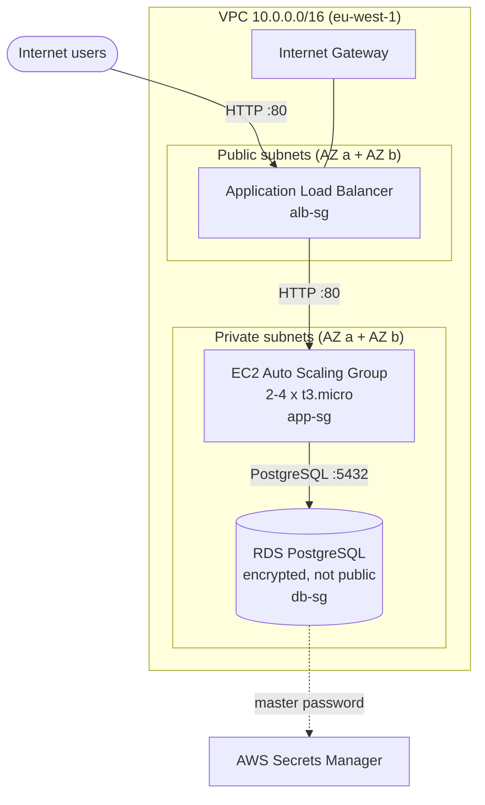

# AWS 3-Tier Architecture with Terraform

A highly available, three-tier web architecture on AWS, provisioned entirely with Terraform. It deploys a multi-AZ network, an Application Load Balancer, an auto-scaling EC2 application tier and a private RDS PostgreSQL database, with security layered between each tier.

## Architecture



## What it builds

| Layer | Resources |
|---|---|
| **Network** | VPC, 2 public + 2 private subnets across 2 Availability Zones, internet gateway, public route table |
| **Security** | 3 chained security groups (ALB → app → database) |
| **Load balancing** | Internet-facing ALB, HTTP listener, target group with health checks |
| **Compute** | Launch template (Amazon Linux 2023, IMDSv2), Auto Scaling Group with CPU target tracking |
| **Database** | RDS PostgreSQL in a private DB subnet group, encrypted, password managed by Secrets Manager |

25 resources in total.

## Key design decisions

**Defence in depth with chained security groups.** Each tier only accepts traffic from the tier in front of it, using security group references instead of IP ranges:

| Security group | Allows | From |
|---|---|---|
| `alb-sg` | HTTP 80 | The internet (`0.0.0.0/0`) |
| `app-sg` | HTTP 80 | `alb-sg` only |
| `db-sg` | PostgreSQL 5432 | `app-sg` only |

**Private application and database tiers.** EC2 instances and RDS have no public IP addresses. The only public entry point is the load balancer.

**High availability.** Subnets, the ALB and the Auto Scaling Group span two Availability Zones. The ASG uses ELB health checks, so unhealthy instances are replaced automatically (tested by terminating instances manually).

**Auto scaling.** A target tracking policy keeps average CPU around 50%, scaling between 2 and 4 instances.

**No secrets in code.** The RDS master password is generated and stored by AWS Secrets Manager (`manage_master_user_password`), so it never appears in Terraform code or the terminal.

**Instance hardening.** IMDSv2 is enforced on all instances, protecting the metadata service against SSRF-style attacks.

**Cost-aware networking.** There is no NAT gateway (which would cost about $32/month). Because the private instances have no internet access, the user data script uses Python's built-in HTTP server, which ships with Amazon Linux 2023, instead of installing packages.

## Project structure

```
.
├── versions.tf      # AWS provider, region, default tags
├── variables.tf     # Region, CIDR, instance sizes
├── vpc.tf           # VPC, subnets, internet gateway, routing
├── security.tf      # Tiered security groups
├── alb.tf           # Load balancer, target group, listener
├── compute.tf       # AMI lookup, launch template, ASG, scaling policy
├── user_data.sh     # Instance bootstrap: web server as a systemd service
├── database.tf      # DB subnet group, RDS PostgreSQL
└── outputs.tf       # ALB DNS name, DB endpoint, secret ARN, IDs
```

## How to deploy

**Prerequisites:** Terraform 1.5+, AWS CLI configured with credentials, an AWS account.

```bash
git clone https://github.com/Izyn/aws-3tier-terraform.git
cd aws-3tier-terraform

terraform init
terraform plan
terraform apply
```

RDS takes about 5–10 minutes to create. When it finishes, Terraform prints the `alb_dns_name`. Wait 3–5 minutes for the instances to pass health checks, then open:

```
http://<alb_dns_name>
```

Refreshing the page shows different instance IDs and Availability Zones, confirming the load balancer is distributing traffic across both tiers.

**Tear down** when finished to avoid charges:

```bash
terraform destroy
```

## Cost

Running the full stack costs roughly **€0.10–0.15 per hour** in eu-west-1 (ALB, 2 × t3.micro, db.t3.micro). The environment is designed to be created and destroyed per session.

## Lab settings vs production

Some settings are deliberately relaxed to keep costs and teardown time low:

| Setting | This project | Production |
|---|---|---|
| RDS Multi-AZ | Off | On (standby in a second AZ) |
| RDS backups | 0 days | 7+ days |
| Final snapshot on delete | Skipped | Taken |
| Deletion protection | Off | On |
| HTTPS | HTTP only | HTTPS with an ACM certificate |
| NAT gateway / VPC endpoints | None | Added for patching and AWS API access |
| Terraform state | Local | Remote (S3 + locking) |

## Roadmap

- [ ] GitHub Actions workflow running `terraform fmt`, `validate` and `plan` on every pull request
- [ ] Remote state in S3 with state locking
- [ ] HTTPS listener with an ACM certificate
- [ ] Refactor into reusable modules (network, compute, database)
- [ ] CloudWatch alarms and dashboard
